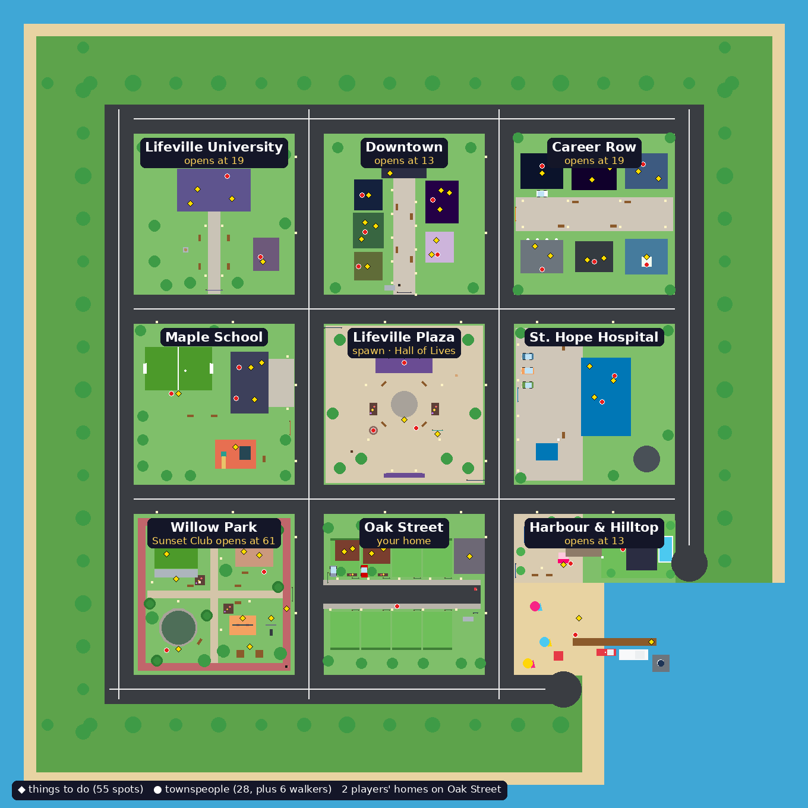

# CHOOSE YOUR LIFE — Roblox life-simulation game

> Every choice you make shapes your future.

**▶ Try it:** download [`build/ChooseYourLife.rbxlx`](build/ChooseYourLife.rbxlx), open it in Roblox Studio and press Play. Full instructions (saving, phone/tablet emulation, multiplayer testing, live sync) are in **[TESTING.md](TESTING.md)**.

Built in Luau as a [Rojo](https://rojo.space) project, so every script is a plain file you can sync into Roblox Studio (or create by hand; see §1).

## Build progress

| Phase | System | Status |
|---|---|---|
| 1 | Architecture: bootstrap, networking, saving, stats, settings | ✅ Done |
| 2 | Main menu, HUD, decision UI, settings, responsive layout (PC / mobile / tablet / console) | ✅ Done |
| 3 | All six life stages (85 scenarios), 34 random events, branching, consequences, yearly income & ageing | ✅ Done |
| 4 | People & bonds, People/Lifestyle/Money panels, investments, loans & mortgages, a scenario for every career | ✅ Done |
| 5 | **Life Reveal**: calibrated predictions, twists, stage & final cinematics, ending titles, Life History, comparisons | ✅ Done |
| 6 | **Multiplayer**: Life Circles, invites, group decisions with voting, group Life Reveals, city events, joining friends | ✅ Done |
| 7 | **Shop & monetisation**: Coins, 81 cosmetics, previews, My Items, look shown in-game, Robux coin packs & passes | ✅ Done |
| 8 | **Lifeville, the 3D town**: 9 districts that open as you grow, 55 things to do, 34 townspeople, your own home, day & night, Life Reveal flyovers | ✅ Done |
| 9 | **Extras**: 50 achievements (7 secret) + Roblox badges, daily rewards & streaks, daily/weekly challenges, Memory Stars, rebirth, leaderboards, profiles, safe trading, tutorial, help, notifications inbox | ✅ Done |
| 10–11 | Security hardening, testing, polish | ⏳ Next (core saving/security done in Phase 1) |

**213 automated tests pass** (`lune run tests/run.luau`). They include:
- a simulation of 400 random lives from age 5 to 85;
- a full life played through the real UI;
- UI click-throughs on desktop, phone portrait, phone landscape and gamepad;
- two players in one server (Life Circles, group votes, city events);
- the shop and Robux purchases (receipts, passes, failed saves, spoofing attempts);
- the generated town (layout, budgets, every spot and person in place) and walking it as a player: prompts, the server's checks, the map, day and night, doors, traffic, homes and the Life Reveal flyover;
- achievements, badges, daily streaks, challenges, Memory Stars, rebirth, leaderboards, profiles and a two-player trade through the real UI.

Nothing has been play-tested inside Roblox Studio yet; see §4.

### Achievements, rewards, leaderboards and trading (Phase 9)

- **🏆 Achievements** (main menu): 50 achievements in 9 categories.
  - They cover lives, careers, family, wealth, the Life Reveal, Lifeville, friends and collecting. Each shows a progress bar and pays Coins once.
  - **7 are secret:** they show "???" and a hint until you unlock them (for example, a wish at the fountain at night).
  - Progress comes from what you actually do, recorded on the server. **Roblox badges** are optional: paste badge ids into `Shared › Data › Badges` (see §3).
- **🎁 Daily rewards and login streaks:**
  - Claim once per day (UTC, from the server clock) for 20 → 150 Coins over a 7-day cycle.
  - Miss a day and the streak starts again. Your best streak is kept.
- **🎯 Daily and weekly challenges:**
  - 3 new ones each day and 3 each week, the same for everyone. For example: "Make 5 decisions" or "Do 20 things around Lifeville".
  - If you can't do one any more (say, "visit a district you've never been to" when you've been everywhere), you get the next one instead.
  - Only progress made after a challenge starts counts. The Coins arrive automatically when you finish.
- **⭐ Memory Stars:** 20 collectibles hidden around Lifeville, one of them secret. The server checks you're next to a star before it counts. Hints are in Achievements → Memory Stars.
- **🌟 Rebirth (Legacy perks):**
  - Every completed life raises your Legacy level and unlocks perks, such as +5 Intelligence, +5 Health or $500 in savings.
  - When starting a new life you can be reborn with one. Perks are earned by playing only, and the server checks you've unlocked the one you pick.
- **📈 Leaderboards:**
  - Five boards: lives lived, richest life, achievements, best login streak and Memory Stars.
  - Each shows **Global** (OrderedDataStores) or **Friends** (your Roblox friends) rankings.
  - A **Hall of Fame** board stands in Lifeville Plaza, and lives and trophies appear in the Roblox player list.
  - Players whose privacy is set to Nobody are left off all of them.
- **👤 Profiles and statistics:**
  - Your profile, or anyone's in the server: look, title, Legacy level, achievements, stars, and lifetime stats (decisions, richest life, endings collected, careers, shifts, trades...).
  - Other players see only what your privacy settings allow.
- **🔄 Trading** cosmetic items between players in the same server, from Play With Friends or a profile:
  - Only items bought with Coins can be traded. VIP items, Coins and anything bought with Robux can't.
  - Pressing Ready locks in exactly the offer you see. Any change un-readies both players, and a 3-second countdown gives time to cancel.
  - The server re-checks everything, swaps both inventories at once, gives the trade an id so it can never apply twice, and saves both players straight away. Both players' trade logs keep a record.
- **🎓 Tutorial:** six short tips that appear at the right moments (first visit, first decision, first outcome, actions, exploring, first Life Reveal). You can skip it, and replay it from Help.
- **❓ Help and support:**
  - Answers to the common questions, built from the real game data (stats, unlock ages, action counts).
  - How to report a player or a bug, and the game version.
- **🔔 Notifications inbox:** everything announced this visit (achievements, challenges, rewards, invites, trades), with an unread count on the menu.

### Lifeville: the 3D town (Phase 8)



*The real generated layout, drawn from above by the test tools (`tests/tools/worldmap.luau` + `render_map.py`).*

- **🌆 Explore** from the HUD (its first button) or the main menu. The menus fade away and you walk round Lifeville with your character. **📝 Next decision** takes you back to the cards.
- **An island town of 9 districts, built by code when the server starts** (about 2,400 parts including people and houses):
  - **Lifeville Plaza:** the spawn, the wishing fountain, the **Hall of Lives** (a pedestal for each save slot) and the town map.
  - **Maple School:** classroom, library, staff room, playground and sports field.
  - **Willow Park:** running track, duck pond, swings, outdoor gym, Willow Arena and the Sunset Club.
  - **Oak Street:** player homes and the apartments.
  - **St. Hope Hospital:** reception, wards, ambulance bay and helipad.
  - **Downtown:** Lifeville Tower offices, the bank, the café, The Golden Fork, the boutique, and the cinema and arcade.
  - **Harbour & Hilltop:** the beach, the pier, boats, the lighthouse and Hilltop Mansion.
  - **Lifeville University:** lecture hall, campus library, evening classes and the student union.
  - **Career Row:** the police station, Starlight Studios & Theatre, the science lab, the courthouse, the workshop and the town hall.
- **The town grows with you:**
  - Downtown and the harbour open at 13, the university and Career Row at 19, and the Sunset Club at 61.
  - Until then a shimmering wall with a sign says when each one opens. The wall is only on your screen, and the server checks as well.
- **Buildings you can walk into**, with sliding doors, furnished rooms, and chairs and benches you can sit on.
- **55 things to do** (press **E**, tap, or press **X** on a gamepad). Each action uses one of your **2 actions between decisions**, the same allowance as the People panel, so nothing can be farmed:
  - study, read, play football, lectures (if you have a university place), evening classes, runs, workouts, feeding the ducks, family picnics, check-ups, volunteering, eating out, chatting in the café, the arcade, films, shows, open-mic night, fishing, swimming, and a trip abroad (which makes you a Traveller);
  - **work an extra shift** at your own workplace (every career has one) for part of your salary and some Career Success;
  - shortcuts: the boutique opens the shop, the bank opens your money, the Hall of Lives lets you choose a life, and the notice board opens the map.
  - Before anything happens, the server checks where you're standing, your age, job, university place, money and unlocks.
- **28 townspeople to talk to**, plus 6 who walk round town. They include the mayor, teachers, a professor, a doctor and nurse, a waiter, a stylist, a judge and a harbour master.
  - What they say depends on your age and career.
  - They can do things with you (help you study, sell you an ice cream, book your trip), open screens, or show you the way.
- **Your home on Oak Street:**
  - Every player gets a plot (8 per server).
  - The house matches your life: the family home as a child, then your own place, a family house or a mansion. Your shop house style, car and pet show up too.
  - "Rest at home" and family dinners only work in your own house.
- **🗺️ Town map:** what's open for you, where you are, and waypoints with a golden guide line.
- **Day and night:**
  - A full day lasts 12 minutes and is the same for everyone in the server (it runs from the server clock).
  - Lamps and windows light up at night.
  - Cars drive the roads, doors slide open, and each district has its own background sound once you add sound ids.
- **Life Reveal flyover:** after the cinematic preview, the camera glides over the real place in Lifeville that matches your likely future: Hilltop Mansion, Lifeville Tower, Starlight Studios, the duck pond and so on.
- **Performance:** everything is anchored, small props don't cast shadows, and streaming is off because the town is small. On Low graphics (automatic on phones), lamps glow without casting light and there are fewer cars.

### Playing with friends (Phase 6)

Every player always has their **own independent life**. Multiplayer adds things to do *together* without ever letting someone else write to your life.

- **🤝 Life Circles** (Play With Friends, or 🤝 in the HUD): invite players in your server (invites expire after 45 s), up to 4 per circle.
  - The leader can remove members, and leadership passes on if the leader leaves; a circle of one dissolves.
  - You can **invite Roblox friends** with the Roblox invite prompt, and **join friends playing in other servers** (teleport).
- **🎲 Group decisions:** the server picks a scenario everyone qualifies for, from 15 group scenarios (start a business together, holiday, band, sleepover, escape room…).
  - Choices someone can't afford are locked for the group.
  - Everyone votes, with a live tally and a 40 s timer. The majority decides; ties and no-shows are settled fairly at random.
  - Chance outcomes are rolled **once for the group** (shared fate). The effects are applied to **each member's own life**, with their own stats, traits and money.
  - Group decisions don't use up a turn or age anyone.
  - Your friends' characters join your People list, and the shared moment shows up in your Final Reveal.
- **🔮 Group Life Reveal:** everyone watches each member's predicted futures, then a **"most likely to…"** board. Privacy settings still apply, and circle members count as friends.
- **⚖️ Compare:** side-by-side futures, stats, net worth and **homes & cars** with anyone whose privacy allows it.
- **🎪 City events:** every 8 minutes the whole server is invited to something (festival, marathon, free concert, market frenzy…). Join or skip; joiners share one city-wide outcome, applied to their own lives.

### Shop, Coins and fair monetisation (Phase 7)

Everything you can buy is **cosmetic**. Nothing changes your choices, stats, money or outcomes, so there's no pay-to-win.

- **🪙 Coins** are earned by playing, and they carry over between lives:
  - +15 for each finished life stage;
  - a payout for each completed life (40 + your overall life score + 5 per future that came true + an ending bonus);
  - +5 for taking part in a group decision or city event.
- **🛍️ Shop** (main menu) has 81 items in 10 categories: clothing, hairstyles, accessories, houses, apartments, cars, pets, furniture, lifestyle (titles, name colours, menu themes) and effects (Life Reveal effects, character auras).
  - Search and category tabs; cards show the rarity, price or Owned/Equipped.
  - Each item **previews on your look** before you buy, and every purchase asks for confirmation.
- **🎒 My Items** (main menu) shows what's equipped in every slot (Change or Remove) and everything you own.
- **Where your look shows up:**
  - **Menu card and HUD:** your face, outfit, accessory and pet, plus your name colour and title.
  - **Your character:** a name tag with your title and name colour, which every player sees, and an aura if you've equipped one.
  - **Other players' screens:** Life Circles, Compare and Group Reveals.
  - **Your Life Reveal:** your home, car and pet appear in your future scenes, and an equipped Reveal effect rains down.
  - **Menus:** an equipped theme recolours the background.
- **Robux (optional, through Roblox's own purchase prompts):**
  - **Coin packs** (developer products): 500, 1,500 or 4,000 Coins.
  - **⭐ VIP** (game pass): 6 exclusive cosmetics for free.
  - **🪙 2× Coins** (game pass): doubles the Coins you earn by playing. Bought Coins are never doubled.
  - Prices are read from Roblox. Until you paste your own ids into `Shared/Data/Monetisation` (see §3), no Robux buttons appear at all.
- **Security:**
  - The server checks every shop purchase: the item exists, you have enough Coins, you don't already own it, and VIP items need VIP. You can only equip items you own, and on load anything unknown or not owned is removed from your loadout.
  - Coin packs are granted in `ProcessReceipt`, at most once per receipt. Roblox is told the purchase succeeded only after your profile has saved; otherwise Roblox retries.
  - Game passes are checked with Roblox every time you join. A pass bought mid-game works straight away. Roblox caches ownership, so it can still report a new pass as "not owned" until you rejoin. The pass is then re-checked on your next join, and removed if Roblox says you don't own it.
  - No remote can grant Coins or passes.

### LIFE REVEAL (Phase 5): the signature feature

**Predictions you can trust.** `Shared/Util/Futures` estimates 11 possible futures: Millionaire, Top of your field, Happy family, Famous, Brilliant mind, Long healthy life, Widely respected, Truly happy, Adventurer, plus two risks (Hard times, Lonely).
- The estimates come from the life's actual state: stats and their trend, money, investments, property, debt, career, level, education, partner, children, bonds, traits, flags, lifestyle focus and age.
- Raw model scores are calibrated (Platt scaling) on simulated lives, then checked on a separate set of lives the fit never saw.
- The test suite proves that from Young Adulthood onward, every common future's predictions beat "just guess the average" and are within 10 points of reality. Odds sharpen as life goes on and change with every decision.
- Re-fit after big balance changes:

```bash
lune run tests/tools/calibrate.luau --fit 800
```

- Report on held-out lives:

```bash
lune run tests/tools/calibrate.luau 600 555
```

**Stage reveals.** At the end of each of the first five stages a cinematic plays:
1. Title with light rays.
2. Who you became.
3. Your possible futures, as counting bars with ▲▼ trend arrows versus the last reveal.
4. A typewriter prediction, such as *"Your decisions suggest you could become a millionaire."*, *"Your financial decisions could put your future at risk."* or *"Your future is uncertain. One major decision could change everything."*
5. An animated preview of the most likely future (11 scenes, e.g. a mansion and sports car for Luxury, a stage with camera flashes for Fame, rain for Hard times… "but it's not too late"), with a slow camera push-in.
6. *"The future is never decided."*

Tap to speed up, Skip to jump ahead, and Reduce animations is respected.

**Twists.** At 22% of reveals something unexpected really happens (`Content/Twists`, 16 twists):
- If one future looks very likely, a **setback** works against it: a crash, a scandal, an illness, a heartbreak.
- If a risk looks likely, a **rescue** helps: a secret inheritance, a new circle of friends.
- Otherwise, a **surprise**: a child prodigy, the big idea, a long-lost sibling.

The reveal shows the odds before and after; on average, setbacks cut the top future's odds by about 28 points.

**Final reveal & ending titles.** At 85, the final reveal covers:
- the choices that shaped you (the most consequential decisions, measured when you made them);
- the people in your life, a net worth count-up, and your career and education;
- achievements, greatest moments and biggest regrets;
- what was predicted vs. what came true;
- your **ending title**, chosen from 23 by what actually happened (The Space Explorer, The Billionaire, The Family Legend, The Celebrity, The Comeback Kid, The Unknown Legend, The Unlucky One, The Quiet Life…), plus coins.

It ends by asking *"What if you had chosen differently?"*, with **Live Again**, **Life History** and **Main Menu** buttons.

**Life History** (menu → 📜). Your last 30 lives, each with a full detail view: replay its final reveal, or **compare two lives side by side**. Completed save slots offer "View Final Reveal".

**🔮 Future panel.** Live odds for every future, how your predictions changed at each reveal, and **compare with players in this server**. Comparisons respect privacy settings: *Everyone / Friends / Nobody* for reveals, exact stats and past lives, using Roblox friendships. Group reveals for Life Circles are described under *Playing with friends*.

### People, lifestyle and money (Phase 4)

- **Named people with bonds (0–100):** every life starts with two parents. Siblings, partners, children and friends join through choices, events and actions; an ex can come back.
  - Bonds fade each year unless you make time for people.
  - Close bonds raise Happiness and pull the Relationships stat up; being alone after 25 hurts.
  - A partner bond below 15 can end the relationship, and ending a marriage costs money too.
- **👥 People panel:** you get **2 actions between decisions**: *Spend time*, *Give a gift* (the cost scales with age) or *Talk* (sometimes a heart-to-heart). There are also *Meet new friends* and, from 18, *Look for love*. Chance-based actions use the life's seeded RNG, so retrying can't reroll them.
- **🎯 Lifestyle focus:** Balanced, Career/School, Family, Health, Social or Save Money. It applies every simulated year; for example, Career focus means faster promotions and fading bonds, and Family focus means growing bonds and a slower career.
- **💰 Money panel:**
  - Net worth (cash + investments + property − debt) and this year's budget line by line. It uses `Shared/Util/Budget`, the same maths the server runs.
  - Invest or withdraw from age 18. Markets average about 6% a year with swings, and crash 5% of the time.
  - Repay loans early.
- **Loans:** university adds a $27,000 student loan, and homes can be bought with a mortgage (deposit plus 25 years). Repayments come out every year.
- **Save upgrade:** save format v2 adds people, focus, investments and loans. The v1→v2 migration turns old saves' partner, children and friend counts into named people.

### What a life looks like now

| Stage | Ages | Decisions | Scenarios | Highlights |
|---|---|---|---|---|
| Childhood | 5–12 | 6 | 11 | first friends, clubs, hidden talents, pocket money |
| Teenage Years | 13–18 | 7 | 14 | friend groups, exams, first job, crushes, going viral, subjects, university plans |
| Young Adulthood | 19–25 | 7 | 17 | university or work or travel, graduation, **career choice** (professional, creative, business or service), moving out, love |
| Adulthood | 26–40 | 7 | 18 (+ multi-stage) | promotions, marriage, children, buying homes, investing, career crossroads, job-specific dramas, **astronaut** |
| Middle Age | 41–60 | 6 | 15 | running a business, raising teens, old regrets, dreams, health, wealth, divorce or late love |
| Retirement | 61–85 | 5 | 10 | retiring (or not), grandchildren, giving back, legacy, looking back |

Between decisions, years pass:
- Salaries are paid, with a savings rate that the Thrifty trait raises.
- Rent is due until you own a home.
- Children cost money while they're young.
- Pensions are based on your career peak.
- Strong performers can be promoted automatically.
- Health declines after 50.

**Multi-stage "Life & Work" scenarios (28):** there is a dilemma for every career, such as a police stakeout, a teacher's struggling student, a chef facing a food critic, a startup pitch, an emergency in orbit and an esports world final. There are also relationship moments (a best friend's wedding, growing apart, work vs. family, lonely evenings, saying goodbye to a parent) and a mortgage-debt dilemma.

After each decision there is a 28% chance of a **random life event**. There are 43 of them, rated Common, Uncommon, Rare or Legendary, and each is gated by your real situation: you can only be laid off if you have a job, and twins need a marriage. Legendary events, like a lottery win or a call from the space agency, happen in only a small fraction of lives.

Results from the 400-life simulation with random choices:
- 84 of 85 scenarios and 33 of 34 events appeared. The exception is the astronaut path, which needs a legendary event.
- 19 different careers were reached.
- Saves stay under 10 KB.
- About 48% of lives ended owning a home and 12% as millionaires.

---

## 1. Where everything goes in Roblox Studio

```
ReplicatedStorage
└─ Shared                              Folder
   ├─ Config                           ModuleScript   constants, credits, loading tips
   ├─ Data                             Folder
   │  ├─ Achievements                  ModuleScript   50 achievements (progress rules, rewards, secrets)
   │  ├─ Assets                        ModuleScript   homes/cars you can buy in a life
   │  ├─ Badges                        ModuleScript   optional Roblox badge ids (paste yours, see §3)
   │  ├─ Catalog                       ModuleScript   81 shop cosmetics, slots, rarities, search, tradability
   │  ├─ Challenges                    ModuleScript   daily and weekly challenge pools
   │  ├─ Collectibles                  ModuleScript   the 20 Memory Stars
   │  ├─ Lifestyle                     ModuleScript   lifestyle focus options
   │  ├─ Careers                       ModuleScript   21 careers, salaries, level titles, education
   │  ├─ DataTemplate                  ModuleScript   save schema, new life, migrations
   │  ├─ Leaderboards                  ModuleScript   the 5 leaderboards
   │  ├─ Legacy                        ModuleScript   rebirth perks
   │  ├─ LifeStages                    ModuleScript   6 stages, ages, decisions per stage
   │  ├─ Monetisation                  ModuleScript   game pass + developer product ids (paste yours, see §3)
   │  ├─ NamePool                      ModuleScript   names for the "Random" button
   │  ├─ NPCs                          ModuleScript   Lifeville's townspeople: looks, lines, options
   │  ├─ SoundIds                      ModuleScript   audio asset ids (fill in, see §3)
   │  ├─ StatDefinitions               ModuleScript   the 8 stats
   │  ├─ Traits                        ModuleScript   13 personality traits
   │  ├─ World                         ModuleScript   districts, unlock ages, workplaces, flyover shots, day clock
   │  └─ WorldSpots                    ModuleScript   the 55 things to do in town (effects, ages, costs)
   ├─ Net                              ModuleScript   (src/shared/Net/init.luau)
   │  └─ RemoteDefinitions             ModuleScript   every remote + rate limits
   └─ Util                             Folder
      ├─ Budget, Daily, Endings, Format, Futures, People,
      │  Signal, StatMath, Style, TableUtil                   ModuleScripts

ServerScriptService
└─ Server                              Folder
   ├─ Main                             Script         (Main.server.luau)
   ├─ Content                          Folder
   │  ├─ CityEvents                    ModuleScript   7 server-wide shared events
   │  ├─ Events                        ModuleScript   43 random life events
   │  ├─ GroupScenarios                ModuleScript   15 group decisions for Life Circles
   │  ├─ Twists                        ModuleScript   16 Life Reveal twists
   │  └─ Scenarios                     ModuleScript   (Scenarios/init.luau) loads + validates everything
   │     ├─ Childhood, Teen, YoungAdult,
   │     │  Adult, MiddleAge, Retirement  ModuleScripts  one per life stage
   │     └─ LifeAndWork                ModuleScript   multi-stage career & relationship scenarios
   ├─ Lib                              Folder
   │  ├─ Actions, CoinRewards, Conditions, Consequences, MockDataStore, MockOrderedDataStore,
   │  │  RandomEvents, Reveal, ScenarioPicker, SessionLock, Validate, Yearly   ModuleScripts
   ├─ Services                         Folder
   │  ├─ ChallengeService, CityEventService, CollectibleService, CosmeticsService,
   │  │  DailyService, DataService, LeaderboardService, LifeService, NPCService,
   │  │  PartyService, PlotService, ProfileService, ProgressService, RevealService,
   │  │  SettingsService, ShopService, StatService, StoreService, TradeService,
   │  │  WorldService                                              ModuleScripts
   └─ World                            Folder         builds Lifeville
      ├─ Builder                       ModuleScript   parts, buildings with doorways, furniture, trees, lamps, cars, prompts
      ├─ Homes                         ModuleScript   player houses on Oak Street
      ├─ Town                          ModuleScript   island, sea, roads, lamps, locked-area walls, every district
      └─ Districts                     Folder
         ├─ CareerRow, Downtown, Harbour, Hospital, Park, Plaza,
         │  Residential, School, University                        ModuleScripts

StarterPlayer
└─ StarterPlayerScripts
   └─ Client                           Folder
      ├─ Main                          LocalScript    (Main.client.luau)
      ├─ Controllers                   Folder
      │  ├─ AchievementsController, AmbienceController, AudioController, CollectiblesController,
      │  │  ControlsController, DailyController, DataController, DayNightController,
      │  │  DecisionController, DialogueController, DoorsController, ExploreController,
      │  │  FinanceController, FriendsController, FutureController, GatesController,
      │  │  GraphicsController, HelpController, HUDController, InventoryController,
      │  │  LeaderboardController, LifeHistoryController, LifestyleController,
      │  │  LoadingController, MapController, MenuController, NotificationController,
      │  │  PartyController, PeopleController, ProfileController, RevealController,
      │  │  SettingsController, SettingsMenu, ShopController, ShowcaseController,
      │  │  StyleController, TradeController, TrafficController, TutorialController,
      │  │  UIController                                              ModuleScripts
      └─ UILib                         Folder
         ├─ Anim, Avatar, Components, Create, Layout, Theme            ModuleScripts
```

```
Workspace
├─ SeaFloor                            Part           sand under the sea (from default.project.json)
└─ SpawnLocation                       SpawnLocation  in Lifeville Plaza
Lighting                                              ShadowMap lighting (project file)
```

At runtime the game also creates:
- **server:** `ReplicatedStorage.Remotes`, **`Workspace.World` (the whole town)**, the sea (Terrain water), and the Lighting effects Atmosphere, Bloom, SunRays and WorldColour;
- **client:** the `CYL_*` ScreenGuis in PlayerGui, the `CYL_Music` / `CYL_SFX` SoundGroups, and `Workspace.CYL_Traffic` (cars only you see).

**Don't create those yourself.** All UI and the town are generated by code; there are no hand-made GUIs or models.

**Want to edit the town by hand?** In Studio (not playing), run this in the Command Bar to bake it into your place:

```lua
require(game.ServerScriptService.Server.World.Town).Build(workspace)
```

WorldService then keeps your `Workspace.World` instead of generating a new one. People and houses still appear when the game runs. Code changes to the districts won't show until you delete the baked `World` and bake again.

File naming (Rojo): `X.server.luau` → **Script**, `X.client.luau` → **LocalScript**, `X.luau` → **ModuleScript**, and a folder containing `init.luau` → a **ModuleScript** with children.

**Option 0, just play it:** open `build/ChooseYourLife.rbxlx` in Studio (see [TESTING.md](TESTING.md)). It's rebuilt from `src/` with:

```bash
rojo build default.project.json -o build/ChooseYourLife.rbxlx
```

**Option A, Rojo (recommended for development):** install the Rojo plugin + CLI 7.x, run `rojo serve` in this folder, then in Studio go to Plugins → Rojo → Connect.
**Option B, manual:** create every object above with exactly those names and classes, and paste in each file's contents.

**Studio settings:** publish the place, then turn on Game Settings → Security → **Enable Studio Access to API Services** to test real saving. With it off, the game warns once and uses memory-only saving.

---

## 2. How the systems connect

```
 CLIENT                                             SERVER
 Main.client → Controllers (Init → Start)           Main.server → Net.Init() → Services (Init → Start)

 LoadingController ─ waits for DataController ──┐
 DataController ── Invoke GetData ─────────────►│ DataService   save/load, session lock, autosave,
        ▲ ◄────── DataSnapshot (own data only) ─┤               sanitized replication
 MenuController ── StartNewLife / ContinueLife ─►│ LifeService   slots, scenarios, choices
                   DeleteLife                    │   ├ Content/Scenarios  (server-only text + effects)
 DecisionController ─ GetScenario / MakeChoice ─►│   ├ Lib/ScenarioPicker (eligibility + weights)
                                                 │   ├ Lib/Conditions     (flags/stats/traits gates)
                                                 │   └ Lib/Consequences   (stats, money, flags, traits, chance)
 SettingsController ─ UpdateSettings/Privacy ───►│ SettingsService (validated against a schema)
 UIController   screens, scaling, modals          │ StatService   authoritative stat changes
 HUDController  HUD + stats panel
```

**The decision loop.**
1. `GetScenario` picks the next scenario: highest `Priority` first, otherwise a weighted pick. Weights are boosted by flags and traits from earlier choices, and scenarios you can't qualify for are skipped. The pick is saved as `life.CurrentScenario`, so reconnecting shows the same one.
2. The client gets titles, choices and **arrow-only previews** (▲▲ Intelligence, ▼ Happiness, 🎲 Risky). It never sees exact numbers or chances.
3. Locked choices are shown with their unlock hint (🔒 "Requires an athletic background"), so players know hidden paths exist.
4. `MakeChoice(scenarioId, choiceId)` is checked against the saved pending scenario and re-checks locks. It then applies all effects in one atomic update:
   - **Short term:** stat changes, with diminishing returns near 0 and 100 and trait multipliers on gains.
   - **Long term:** flags (which unlock or close off later scenarios and choices) and traits (which make related gains worth more later).
   - It also updates money, the story log and the decision log.
5. **Years pass** (`Lib/Yearly`): income, rent, children's costs, pension, career years, automatic promotions and ageing.
6. **Random events** (`Lib/RandomEvents`) may then fire. The outcome card shows what changed, and an event card follows if one happened.
7. Chance rolls use a per-life server seed plus the decision count, so leaving and rejoining can't reroll a bad outcome.
8. After the last decision of a stage, the stats are snapshotted into `life.Reveals` and `StageCompleted` fires. This is where Life Reveal plugs in during Phase 5.

**Branching between stages.** Choices set *flags* (Athlete, MusicTalent, PlanUni, Cheater…) and *traits* (Studious, Kind…). Later scenarios and choices use `Requires` to test flags, traits, stats, money, career, education, relationship status, children and assets. Examples:
- A childhood swimmer can beat the bully in a race.
- A teen who started a channel gets the brand deal at 22.
- A childhood chess player can win the senior championship at 75.
- A science grad can be invited to train as an astronaut.

**Content validation.** At startup, `Content/Scenarios` checks every scenario and event: unique ids, 3–5 choices, valid stats, traits, careers, education and assets, and outcome chances that add up to 1 or less. It also checks that every purchase of $10,000 or more is guarded by a `MinMoney` requirement. Any problem prints a warning in Output, and the test suite fails on it.

**Responsive UI.** Every screen is laid out in virtual pixels on a 1280×720, 960×540 (phone landscape) or 540×960 (portrait) canvas, then scaled with `UIScale` to fill the safe area. Below 900 virtual pixels wide, layouts stack: the decision cards become a list, the HUD uses two rows and the menu becomes one column. Screens rebuild live when the device rotates or the UI-scale setting changes. All controls are buttons, so touch, mouse and gamepad all work. Sliders also have −/+ buttons.

**Input.**
- **Mouse/touch:** tap a card to select it, then tap again or press Confirm.
- **Keyboard:** `1`–`5` selects a choice, `Enter` confirms or continues.
- **Gamepad:** D-pad to move, A to press, and B to cancel a selection or go back.

**Settings** apply instantly and save about 0.8 s after the last change (failed saves retry with the next change).
- **Graphics:** Auto / Low / High controls shadows, post-effects and decorative motion. Auto picks Low on touch-only devices.
- **Camera sensitivity:** saved and exposed for the game's own camera systems. Roblox doesn't let games change the default camera's mouse sensitivity.

---

## 3. Things you need to add in Studio

- **Sounds and music:** paste asset ids you have rights to (Toolbox → Audio) into `Shared/Data/SoundIds`. Empty ids are skipped, so the game is silent until then. The volume settings already control them.
  - For Lifeville: `WorldMusic` (while exploring), one ambient loop per kind of district (`AmbientPlaza`, `AmbientSchool`, `AmbientPark`, `AmbientResidential`, `AmbientHospital`, `AmbientCity`, `AmbientHarbour`), `AmbientNight`, and `BuskerMusic` (heard near the busker in the Plaza).
  - `Splash` (the wishing fountain) already works: it uses a sound built into Roblox.
- **Animations:** the townspeople use Roblox's default character animations (idle, walk, wave, point, dance), so there's nothing to add.
- **Roblox badges (optional):** the game works without them.
  1. Creator Dashboard → your experience → **Associated Items → Badges** → Create a Badge. Roblox limits how many free badges you can create per day.
  2. Copy each badge's id into `ReplicatedStorage › Shared › Data › Badges`: `Welcome` (first time playing) and `ForAchievement` (one per achievement you choose; 12 are listed ready to fill in).
  3. Players who already unlocked an achievement get its badge the next time they join.
- **Leaderboards:** they need DataStores, so publish the place and turn on Studio API access (see TESTING.md). Without that, Studio uses a temporary board that resets when you press Stop.
- **Support text:** edit `Config.Support` (shown in Help) to tell players how to reach you.
- **Max players (optional):** Oak Street has 8 house plots. If you want every player to get a home, set Game Settings → Places → Max Players to 8 or fewer. Anyone beyond 8 can still do everything except the home actions.
- **Credits:** edit `Config.Credits`.
- **Robux products (optional):** the game works fully without them, using Coins earned by playing.
  1. Publish the place (File → Publish to Roblox).
  2. In the [Creator Dashboard](https://create.roblox.com/dashboard/creations), open the experience → **Monetization**:
     - **Passes:** create **VIP** and **2× Coins**, and set each one's price and put it on sale.
     - **Developer Products:** create the three coin packs (500, 1,500 and 4,000 Coins) with prices.
  3. Copy each id into `ReplicatedStorage › Shared › Data › Monetisation` (`Id = 0` → your id).
  The **Get Coins** button and the VIP offers appear once at least one id is set. Names shown in-game come from that file, and prices come from Roblox.

---

## 4. Testing

```bash
lune run tests/run.luau
```

```bash
selene src
```

Tests run the **real** `src/` files outside Roblox using [Lune](https://lune-org.github.io) and a fake Roblox API (`tests/harness.luau`). The client tests boot the real client against a real server harness, with remotes bridged and data deep-copied. They then click through the loading screen, menu, name entry, a whole life, the stats panel, settings, credits, save slots and delete confirmation, the shop (search, tabs, previews, buying, VIP, coin packs) and My Items. This runs at desktop, phone-portrait, phone-landscape (including rotating mid-decision) and gamepad layouts, and the tests fail on any script error.

**What the harness can't check:** how things actually look, fonts, real tween timing, and real DataStore and text-filter behaviour. Please play-test in Studio. You should see:
- Output shows `[Server] CHOOSE YOUR LIFE started with 20 services` and no red errors.
- The loading screen leads to the main menu. **Play** leads to name entry, then to decision cards.
- Use Studio's **device emulator** (Test → Device) to check a phone and a tablet.
